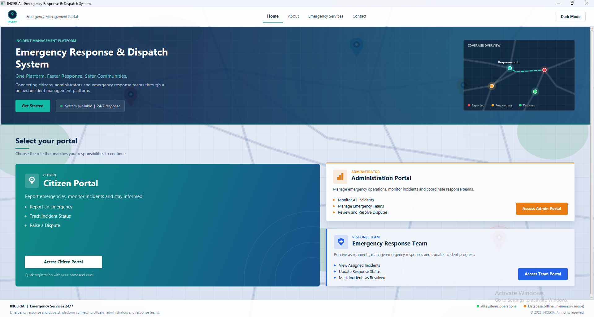

# Incident Management System

## Overview
Brief introduction to your project.

## Technologies Used
- Java
- JavaFX
- SQL Server
- JDBC

## Features
- Citizen incident reporting
- Admin authentication
- Incident management
- Dispute management
- Fire brigade team management

## Project Architecture
- Business Layer
- Data Layer
- UI Layer

## Application Screenshots

### Main Dashboard

### Admin Panel

### Incident Reporting

## Project Structure

## Installation and Setup

## Database Configuration

## How to Run

## Demo Credentials
(Only include safe demo/test credentials, never real passwords.)
