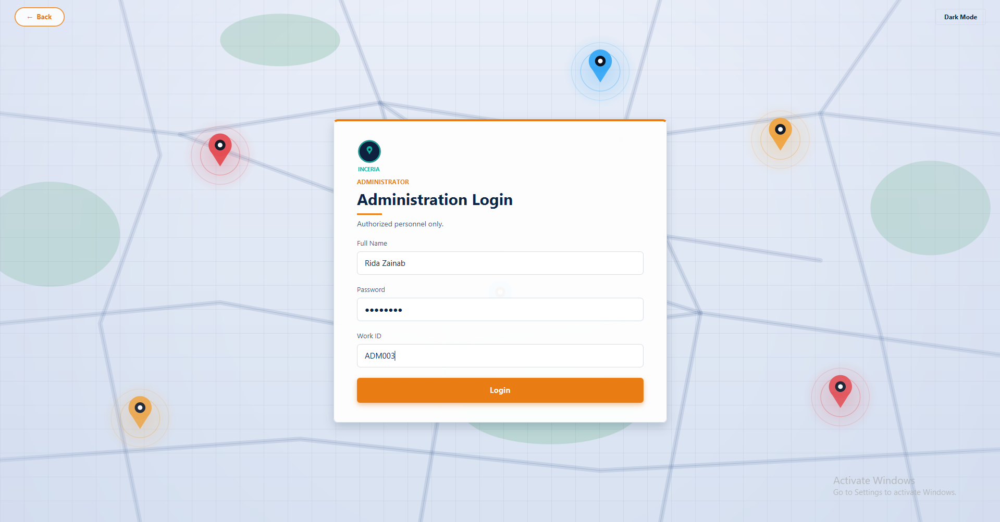
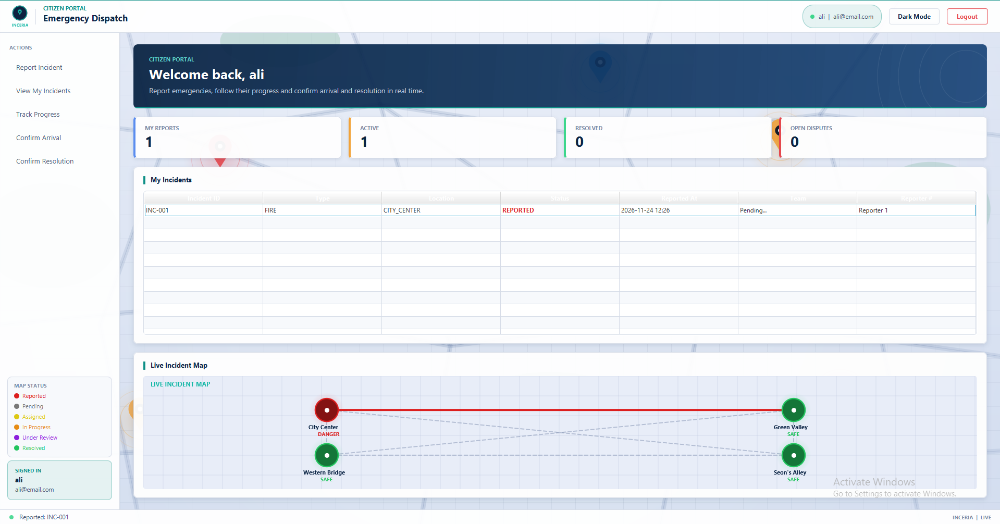

# Incident Management System

## Overview
Brief introduction to your project.

## Technologies Used
- Java
- JavaFX
- SQL Server
- JDBC

## Features
- Citizen incident reporting
- Admin authentication
- Incident management
- Dispute management
- Fire brigade team management

## Project Architecture
- Business Layer
- Data Layer
- UI Layer

## Application Screenshots

### Main Dashboard


### Admin Panel


### Incident Reporting


## Project Structure

The project follows a layered architecture to separate user interface, business logic, and data management.

```text
Incident-Management-System/
│
├── src/
│   ├── UILayer.java
│   ├── BusinessLayer.java
│   └── DataLayer.java
│
├── lib/
│   ├── JavaFX libraries
│   └── SQL Server JDBC Driver
│
├── screenshots/
├── .gitignore
├── README.md
└── .classpath
```

## Installation and Setup

1. Clone the repository:

   ```bash
   git clone https://github.com/zaynab123-code/Incident-Management-System.git
   ```

2. Open the project in an IDE such as Eclipse or VS Code.

3. Make sure Java JDK and JavaFX are installed and configured.

4. Ensure the required libraries in the `lib` folder are available in the project build path.

## Database Configuration

This application uses Microsoft SQL Server for database connectivity.

- Install and configure Microsoft SQL Server.
- Create the database required by the application.
- Update the database connection settings in `DataLayer.java`.
- Ensure the SQL Server JDBC driver is configured correctly.


## How to Run

1. Open the project in your IDE.
2. Verify JavaFX and SQL Server JDBC configurations.
3. Ensure the SQL Server database is running.
4. Run `UILayer.java` to launch the application.


